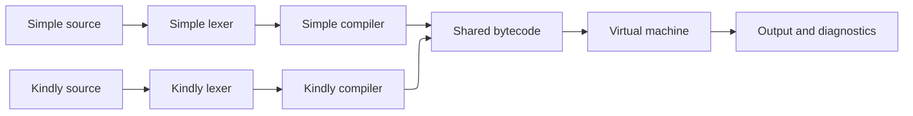

## Overview

Kindly is a programming language and bytecode interpreter written in GDScript, with an Astro/React playground that runs the same interpreter in the browser through Godot's Web export.

It began with a practical requirement. I was building a game in Godot and wanted players to write scripts that could interact with the game world through a small set of native functions.

The interpreter was later extracted into a standalone language project. Kindly has two frontends: a Python-like language called Simple, and a polite corporate-email syntax that gives the project its name. Both compile to the same bytecode and run on the same virtual machine.

> The language supports variables, functions, closures, control flow, lists, dictionaries, deques, and a small standard library.

I designed and built the backend: the interpreter, compiler, language frontends, standard library, test suite, and browser bridge. I left the website's visual and interaction layer to GPT, since it was mostly grunt work I have done many times (see this website).

## Architecture

### Why a Bytecode VM

I used Robert Nystrom's [_Crafting Interpreters_](https://craftinginterpreters.com/) as the implementation guide. The book builds two interpreters: `jlox`, which walks an abstract syntax tree, and `clox`, which compiles source into bytecode for a stack-based virtual machine.

Because the game needed scripts to step and pause line by line, `jlox` was a poor fit. `jlox` evaluates the tree recursively, so pausing between statements would require preserving that recursion through an explicit continuation stack. `clox` avoids the problem because each instruction is a separate unit of work. The virtual machine can stop between instructions and resume from the same program counter.

### Shared Compiler and VM

Each frontend tokenises source code and feeds the same compiler core and virtual machine. The same program semantics can therefore be expressed as:

```python
var count = 0
count = count + 1
print(count)
```

or as:

```text
Dear Compiler,

Please let count be 0.
Please update count to count + 1.
Kindly execute print(count).

Best regards.
```

Both versions produce the same output. Each frontend emits the same token types, which the shared compiler consumes. The interpreter then has three stages:

1. **Lexing:** Convert source code into tokens.
2. **Compilation:** Parse the tokens and generate bytecode.
3. **Execution:** Interpret the bytecode using a virtual machine.



The shared compiler handles expressions, bindings, scopes, and bytecode generation. Each frontend supplies the statement-level grammar: declarations, blocks, statement termination, and keyword or phrase matching.

## Lexing Python-Like Syntax

The lexer was the largest frontend-specific part of the project.

A brace-delimited language can treat whitespace as insignificant. A Python-like language cannot. Indentation is part of the grammar, so the lexer has to convert layout into structural tokens before the compiler can parse blocks. I referenced CPython's tokenizer for those rules, particularly how indentation, dedentation, and logical line endings interact.

### Indentation Tokens

The lexer maintains a stack of indentation levels and emits `INDENT` and `DEDENT` tokens when the source enters or leaves a block.

The lexer turns this source:

```python
if condition:
	if other_condition:
		print("World")
	print("Done")
```

into this token stream:

```text
IF ... COLON NEWLINE
INDENT IF ... COLON NEWLINE
INDENT ... NEWLINE
DEDENT ... NEWLINE
DEDENT EOF
```

Kindly accepts only tabs for indentation. A dedent must match an earlier indentation level. If it does not, the lexer reports an error rather than guessing which block the line belongs to. (Similar to CPython)

Blank lines and comment-only lines are ignored when determining indentation. Their whitespace cannot accidentally create or close a block.

Once layout is represented this way, it is surprisingly close to a brace-delimited language. `INDENT` acts like a left brace and `DEDENT` acts like a right brace. Python's function-level scoping is the main difference I did not carry over; Kindly uses C-like block scoping instead. That keeps the parser's scope handling close to `clox`, so the indentation frontend maps cleanly onto the existing compiler structure.

### Logical Lines and Brackets

The lexer also distinguishes physical newlines from logical statement boundaries. Newlines inside parentheses, brackets, or braces do not end a statement, and indentation inside those delimiters does not create a new block.

Kindly uses a bracket stack for two purposes: validating matching delimiters and marking continuation regions. If bracket validation sounds familiar, it's because it's the same algorithm from LeetCode's [Valid Parentheses](https://leetcode.com/problems/valid-parentheses/)! (Do your LeetCode, folks!)

Inside brackets:

- newlines are not emitted as statement boundaries,
- indentation changes are ignored,
- spaces are allowed for alignment.

This allows a list or dictionary literal to span several lines without turning its formatting into block structure:

```python
var records = [
    {"name": "Alice", "scores": [1, 2]},
    {"name": "Bob", "scores": [3, 4]}
]
```

Bracket continuation produced most of the lexer bugs. A newline inside a bracket has to suppress both the logical newline and any pending indentation change, while still leaving the following physical line in the correct state.

That requires tracking the current indentation, the indentation stack, the open brackets, whether line-start processing is pending, and whether the current logical line already contains code. A small explicit flag controls when indentation is processed at the start of a line.

### Keyword Lookup with a Trie

Both lexers use a trie for exact keyword lookup. It avoids a long chain of string comparisons and keeps the keyword set easy to extend. Between the trie and the bracket stack, two classic LeetCode data structures have now appeared in a real lexer.

## Compilation Without an AST

Kindly compiles expressions directly into bytecode using a Pratt parser. It does not build an intermediate abstract syntax tree.

Rather than following the book's precedence enumeration, I gave each operator explicit left and right binding powers. I found binding powers more intuitive, since the numbers directly express precedence and associativity.

### From Source to Bytecode

The compiler emits instructions as it parses. For example, this Simple program:

```python
var count = 0
count = count + 1
print(count)
```

Compiles to the following bytecode, with constant operands shown as names or literal values for readability:

```text
CONSTANT 0
DEFINE_GLOBAL count
GET_GLOBAL count
CONSTANT 1
ADD
SET_GLOBAL count
POP
GET_GLOBAL print
GET_GLOBAL count
CALL 1
POP
RETURN
```

Direct bytecode generation keeps the compiler focused on one representation. There is no separate tree to allocate, traverse, and then lower. The tradeoff is that diagnostics and language changes must be reasoned about at the bytecode-generation level rather than in a reusable tree representation.

### Assignment as an Expression

I first implemented assignment as a statement, following CPython's grammar. That was simpler but did not support chained assignment:

```python
count = count + 1
```

Subscript assignment exposed the limitation. A statement form could not represent arbitrary nested targets cleanly, particularly once assignments appeared inside list and dictionary expressions. Consider an assignment target that itself contains an expression:

```python
records[index + 1]["scores"][0] = 10
```

With assignment as a statement, the parser would have to recognise the entire target before parsing the right-hand expression. Because the target can contain nested subscripts and arbitrary expressions, that requires unbounded lookahead and repeated reparsing as the parser works out where the target ends.

Therefore, I changed assignment to an expression, following the book's design, with a `can_assign` flag to distinguish a writable target from an ordinary value. This also made chained assignment possible.

In practice, this makes `=` behave more like Python's `:=` than its assignment statement. A Kindly assignment produces a value and can appear inside another expression, which Python reserves for the walrus operator.

### Compiler Errors Without Exceptions

Kindly reports only the first compiler error. This was partly for simplicity and partly to match CPython's behaviour. It also felt appropriate for this language: after a mismatched dedent, there is no reliable way to infer what the user intended, so reporting the error is more honest than guessing.

The drawback is how the compiler has to propagate that first error through GDScript. GDScript has no exceptions, which is one of my pet peeves with the language. That would have mattered less if I had kept `clox`'s parser recovery, but with first-error reporting, every failure has to preserve the diagnostic, stop further declarations, and leave the partial function safe to discard.

The `for` parser shows how repetitive that becomes. It has to clean up temporary locals for the counter, bound, and step:

```gdscript
var local_index: Variant = _declare_local(name)
if local_index == null:
	_end_scope()
	return

var end_local_index: Variant = _declare_local("", true)
if end_local_index == null:
	_end_scope()
	return

var step_local_index: Variant = _declare_local("", true)
if step_local_index == null:
	_end_scope()
	return
```

An exception could carry the diagnostic past all of this cleanup and let the top-level compiler discard the partial function. Instead, each failure has to unwind the parser's state correctly in place.

Diagnostics are still returned as structured values rather than printed by the interpreter. The host application can display the message, source line, and character range in the editor.

## Virtual Machine and Closures

### Separating Locals from the Operand Stack

In `clox`, local variables and temporary expression values share the same VM stack. Each call frame stores an offset into that stack, and local variables are addressed relative to the frame's starting position.

I initially implemented a similar arrangement. Adding closures exposed a problem with keeping local storage and operand evaluation on the same stack. Captured locals need to keep their identity after the enclosing frame returns, while temporary operands only need to exist for the duration of an expression.

Instead, I separated the two responsibilities. The operand stack holds temporary values during expression evaluation, while each call frame owns an array of local cells.

### Cells

A `Cell` is the storage location for one variable binding:

```gdscript
class_name Cell
extends RefCounted

var value: Variant
```

The value can change, but the cell's identity does not. The compiler still resolves a local to a numeric index, so runtime access remains an array lookup rather than a name search.

The purpose is to give each binding a stable, heap-allocated location. A closure does not copy the variable's current value; it retains a reference to the cell. That is what lets a captured variable outlive its frame and remain shared between several closures.

`clox` takes a different route. Locals live on the VM stack, and a captured variable starts as an open upvalue pointing into that stack. When the variable's scope ends, the upvalue closes and takes ownership of the value. That transition assumes an addressable stack slot. GDScript has no equivalent pointer model, so I represented every local as a reference-counted object from the start.

This simplified capture and return handling. The tradeoff is an allocation and indirection for every local, including ones that are never captured. A captured cell can also contain a closure that references the same cell, creating a reference cycle.

### Reference Cycles

Godot manages `RefCounted` objects with reference counting rather than tracing garbage collection. An object is released when its reference count reaches zero, so two objects that retain each other can keep each other alive indefinitely.

A local recursive closure can capture the cell that contains the closure itself:

```python
def outer():
    def self_ref():
        return self_ref
    return self_ref

var escaped = outer()
```

`outer()` returns `self_ref`, which captures its own binding. The cell contains the closure, and the closure retains the cell, so neither reference count reaches zero.

I originally handled this with a registry of closures held through Godot's `weakref()` API. A weak reference does not count towards an object's reference count, so Godot can still reclaim ordinary acyclic closures during execution. The registry can then inspect the references at the end of the run and find any closures that survived because of a cycle.

Collections made this registry insufficient. Lists, dictionaries, and deques can contain themselves, reference one another, or contain closures that capture those containers. Godot also cannot create a `weakref()` for a raw array, so a list cannot be registered and checked the same way as a closure. Cleaning up closure captures alone would leave unreachable collection cycles behind.

### The Session Heap

Instead, I used a session heap. Every language-managed list, dictionary, deque, and closure is allocated through the heap. When execution finishes, the heap clears the contents of those objects before releasing its own references.

This breaks reference cycles and lets Godot's reference counting reclaim the objects. Cleanup runs after success, runtime errors, native-function failures, and instruction-limit termination.

The session heap uses strong ownership, so its tradeoff is broader than the old closure registry's. Ordinary acyclic values also remain allocated once they become unreachable, rather than being released during execution. This is not tracing garbage collection, and memory use can grow during a long-running script.

I could return to weak tracking by wrapping raw containers in a `RefCounted` type that Godot can weak-reference. That is planned only if profiling shows allocation retention is a bottleneck. A proper tracing collector is the longer-term replacement if Kindly needs to support sustained execution.

## Bytecode Constraints

Kindly stores instructions in a `PackedByteArray`, with operands encoded using fixed-width integers.

Many instructions use one-byte indices, imposing limits on constant pools, locals, captures, arguments, and collection-literal sizes. Without explicit validation, an index could wrap and address an unrelated slot.

The compiler checks these limits before emitting an instruction. Constant and capture failures propagate to their callers instead of leaving partial or invalid bytecode behind.

### Signed Relative Jumps

Unlike `clox`, which uses separate instructions for forward jumps and backward loops, Kindly uses signed 16-bit relative offsets.

This allows one jump instruction to move in either direction. The valid range is -32,768 through 32,767 bytes relative to the instruction following the operand. The compiler checks that range both when emitting a backward jump and when patching a forward jump.

### Constant Deduplication

Kindly stores constant indices in one byte, so each compiled function has at most 256 constant-pool entries. Without deduplication, repeated literals and names in the same function can exhaust that pool quickly. Before adding a number or string, the compiler searches the current function's pool for an identical type and value and reuses its index.

Deduplication happens before the capacity check, so a full pool can still refer to an existing constant. Integer `1` and float `1.0` remain distinct entries even though numeric comparison can consider them equal.

Deduplication is another place where the implementation improves on `clox`.

## Running the Interpreter in the Browser

To let visitors try the interpreter without installing Godot, I reused the existing GDScript implementation through Godot's Web export. The website uses Astro and React for the editor and console, while a Godot WebAssembly runtime executes the scripts.

The result is several layers of execution. JavaScript runs in the browser, loads a Godot WebAssembly build, and starts the GDScript interpreter. That interpreter compiles Kindly or Simple source, and Kindly's virtual machine executes the resulting bytecode. In other words, a Kindly VM is interpreting bytecode, running on GDScript, running under Godot, running in WebAssembly, running inside JavaScript.

### Editor Integration

The browser editor uses CodeMirror, but it does not maintain a second implementation of either language's lexer.

As the user types, the page sends a debounced tokenization request to the Godot runtime. The lexer returns source spans and presentation categories such as keyword, identifier, string, and comment. The editor turns those spans into syntax highlighting.

Highlighting therefore follows the language's actual lexer, including Kindly's contextual phrases. The JavaScript side owns editor-only behaviour such as completions, snippets, indentation hints, and diagnostic rendering.

Strict scanning returns the first error and discards the token stream. That is useful for compilation, but not for an editor full of unfinished text. The editor path therefore uses a recovery mode that skips malformed input, emits comments, and marks unknown characters as invalid. Highlighting can continue without weakening the compile-time error contract.

## Tradeoffs and Hindsight

### Stack Slots vs Frame-Owned Cells

The conventional `clox` layout keeps locals on the value stack and gives each frame a base offset. It is compact and avoids a separate allocation for every local. Frame-owned cells make captured and uncaptured locals use the same representation. Closures can retain those cells directly, and the VM does not need a separate open-to-closed upvalue transition.

The cost is an allocation and indirection for every local. If the language needed to optimise non-capturing locals aggressively, I would add a representation that avoids cells for values that cannot escape.

### Session Heap vs Tracing Garbage Collection

A tracing collector can reclaim unreachable cycles during execution and avoid retaining dead objects until the program ends. The session heap is much smaller. It relies on a clear execution boundary and a strong ownership registry. Every allocation remains alive until that boundary, which is acceptable for short playground runs but unsuitable for a long-running process with sustained allocation. If Kindly became a long-running embedded runtime, it would need a different memory policy.

## Outcome

Kindly is a working bytecode language implementation with a shared compiler and virtual machine, two implemented frontends, collection support, a standard library, a tested session-based memory policy, and a browser playground that reuses the GDScript interpreter through Godot's Web export.

Both frontends compile to the same bytecode. The lexer carries the layout and phrase rules for each language; the compiler and VM do not need to know which surface syntax produced the tokens. Changing the language changed how the program was read, not how it ran.
